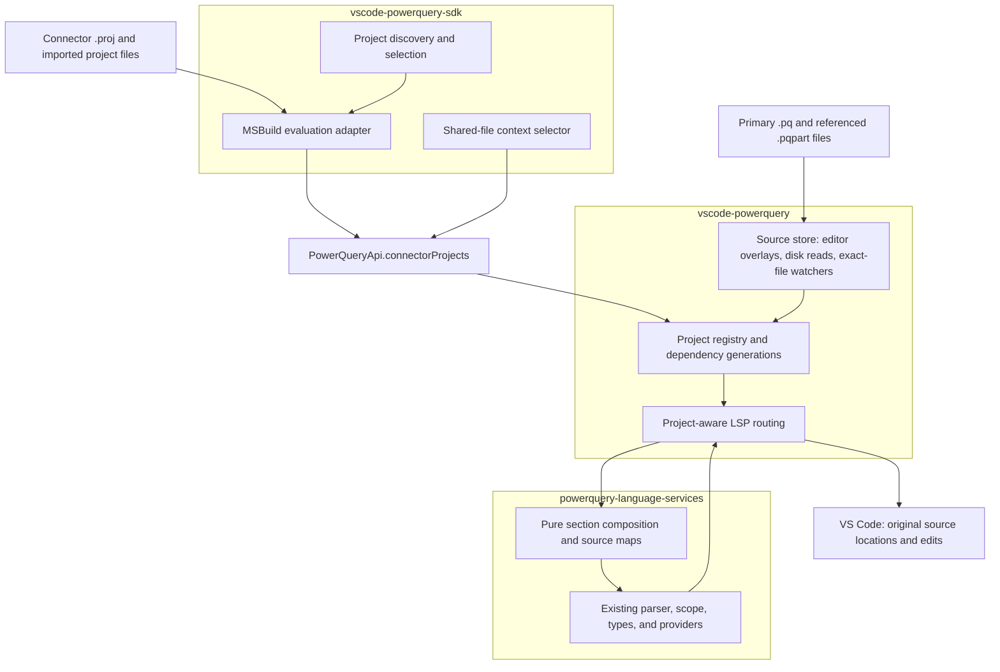

# Project-aware language services for connector parts

**Status:** Proposal for review; no runtime implementation is included.

## Recommendation

Keep the proposed ownership split: the Power Query SDK discovers connector projects
and opts them in through the language extension's public API. The language extension
owns source loading, editor synchronization, and LSP routing. The
`powerquery-language-services` package owns editor-independent composition and
source-position mapping.

The important refinement is to register **project source membership, not a list of
library symbols**. Analyze the primary `.pq` and its ordered `.pqpart` bodies as one
in-memory section document. This matches the build's semantics and lets existing
scope/type analysis handle private members, mutual references, and local shadowing.
Map all results back to the original files; never write a generated connector file
for the editor to consume.

For `.resxpart`, retain XML language mode and register resource membership, but do
not turn resource names into M identifiers. Cross-file resource-key validation and
resource-string IntelliSense are separate follow-up work.

## 1. Goals and boundaries

The initial implementation should:

- Resolve members from explicitly included parts when editing the primary `.pq`,
  including members without `shared`.
- Resolve references in both directions: primary-to-part, part-to-primary, and
  part-to-part, with the same lexical scoping as the merged section.
- Support diagnostics, completion, hover, signature help, definition, semantic
  tokens, and safe rename across source boundaries.
- Preserve document-local formatting, folding, and outline behavior.
- Support referenced parts outside the workspace/connector directory and one part
  included by multiple connectors, without leaking private symbols between projects.
- Reflect unsaved M edits, closed-file disk changes, project membership changes,
  and configuration changes without requiring a connector build.
- Leave ordinary Power Query editing unchanged when the SDK does not register a project.

Not included:

- Scanning every `.pqpart` beneath a workspace and implicitly importing it.
- Adding another M grammar, true multi-section analysis, or `PartSection!Member` rewriting.
- Evaluating M, building a `.mez`, or loading generated `obj` content for IntelliSense.
- Automatically discovering every consumer of a shared file outside registered projects.
- Adding an LSP references or workspace-symbol provider; neither is currently advertised.
- Replacing XML tooling, validating localized resource sets, or changing resource lookup.

## 2. Existing behavior and implications

PR [#303](https://github.com/microsoft/vscode-powerquery/pull/303) registers `.pqpart`
with the Power Query language and `.resxpart` with XML. It also tests language
association and document symbols. It does not establish project membership or
cross-file scope.

| Component | Current behavior | Design implication |
| --- | --- | --- |
| Language extension API | Exports `onModuleLibraryUpdated`, `addLibrarySymbols`, and `removeLibrarySymbols`. | Add a source-project API without changing these contracts. |
| SDK activation | Sends compiled connector exports through `onModuleLibraryUpdated`, associated with the first workspace folder. | New discovery must enumerate projects across all workspace roots, not inherit first-folder selection. |
| LSP handlers | Create analysis from the requested open document; validation has a separate construction path. | Both paths must use the same project snapshot, not just change completion or unknown-identifier checks. |
| Module library lookup | Associates symbols using a URI prefix. | Explicit source membership must use normalized URI identity, including external files. |
| Library cache | Keyed by locale and mode, while dynamic module definitions capture a document URI. | A project-sensitive library must not reuse another project's captured lookup. |
| Analysis cache | `AnalysisUtils.analysis` caches by document URI and version. | A dependency edit must invalidate analysis even if the requested document's version is unchanged. |
| Definition and rename | Definitions use the analysis document URI; rename returns edits that the server assigns to one document. | Composition requires mapping locations and distributing edits across physical URIs. |
| Pull diagnostics | Advertises `interFileDependencies: false` and `workspaceDiagnostics: false`. | Set inter-file dependencies to true and refresh affected document reports on dependency changes. |

These are integration constraints, not a proposal to refactor unrelated SDK or LSP
behavior.

## 3. Semantic contract with the build

The supplied build design and `PqPartMerger` establish the following rules:

1. `MezPart` is the item name for both extensions. Filter by extension while
   preserving item order within each kind. Do not sort or deduplicate includes.
2. Prefer the explicit `MezSource` item; otherwise require exactly one `.pq` in
   `MezContent`. MSBuild item names are case-insensitive, so `MEZContent` is equivalent.
3. Each `.pqpart` is a section document. Its decoded section name must match its
   filename without extension using ordinal, case-sensitive comparison.
4. The part header, including document attributes preceding `section`, is not
   active code in the merged connector. Its body joins the primary section.
5. Both private and `shared` section members participate. Declaration order does
   not impose an execution order; normal M scope and lazy evaluation rules still apply.
6. Duplicate names across files remain duplicate definitions. There is no
   first-wins or last-wins policy, and repeated includes must remain observable.
7. Parts are not separate modules, and their section names are not namespaces.
   Existing limitations around dynamic `#shared`/`#sections` inspection remain.
8. The primary `.pq` retains its document attributes and section identity.

For example:

```xml
<ItemGroup>
  <MezContent Include="FabricConnector.pq" />
  <MezPart Include="..\Shared\FabricShared.pqpart" />
  <MezPart Include="Connector.Private.pqpart" />
  <MezPart Include="..\Shared\FabricStrings.resxpart" />
</ItemGroup>
```

```powerquery
// FabricConnector.pq
section FabricConnector;
shared FabricConnector.Contents = () => FabricRequest("https://example.com");
```

```powerquery
// ..\Shared\FabricShared.pqpart
section FabricShared;
FabricRequest = (url as text) as binary => Web.Contents(url);
```

`FabricRequest` resolves in the primary file without becoming a public library
export. Go to Definition opens the original shared file. An unrelated connector
does not see it unless that connector also includes the part.

The build spec's later conversion example uses `section FabricCommonUtils` in
`Utils.pqpart`, which conflicts with its stated filename rule and the inspected
merger implementation. Follow the implemented rule (`section Utils` for that
filename); correct that example separately.

## 4. Component architecture



**Ownership invariant:** the SDK decides *which files belong together*; the
language extension decides *which text is current*; language services decides
*what that text means*. No component separately implements a symbol-only view of
the project.

### Why not export parsed parts as library symbols?

That would be a useful prototype for suppressing unknown-name errors, but not the
feature contract. Library JSON does not represent declaration identity, lexical
scope, source locations, cross-file rename, duplicate section members, or live
source dependencies. Injecting private members also risks making them visible to
unrelated files.

Composition is preferable to modifying the parser to accept multiple sections:
the build already produces one section, and `.pqpart` already uses the existing
section grammar. No parser or formatter package change is expected initially.

## 5. SDK project discovery and evaluation

### Discover projects, not source directories

Create a focused project-language-service coordinator in the SDK. Enumerate
`.proj` files in each workspace root, excluding build/output and dependency
directories. Recognize connector projects from their evaluated connector items;
do not enable every MSBuild project or choose the first `.pq` found.

For each connector, record the project URI, selected build properties, primary
source, ordered parts, optional primary resources, and known evaluation inputs.
Different projects can have independent registrations. Initially maintain one
selected configuration per project; switching configuration replaces that
project's descriptor and increments its revision.

A companion `*.query.pq` that is not a build input stays a standalone query. It
can continue using the existing compiled-export library mechanism, but must not
gain a connector's private part members merely because it is nearby.

### Use evaluated MSBuild items

Do not implement an approximate MSBuild interpreter by scraping XML `Include`
attributes. Imports, properties, conditions, item lists, globs, `Remove`, and
`Exclude` can change both membership and order.

The agreed approach uses MSBuild 17.8+ item/property query support, without
requesting any targets or introducing a direct XML-parsing fallback. Conceptually:

```text
MSBuild.exe Connector.proj -nologo
  -getItem:MezSource,MezContent,MezPart,MezResources
  -getProperty:MSBuildAllProjects
```

Supply the same selected global properties as the build through process arguments,
not shell interpolation. Consume the JSON `Items` collections and their `FullPath`
and `DefiningProjectFullPath` metadata. Item-query support and its version floor
are documented in
[Evaluate items and properties without a build](https://learn.microsoft.com/en-us/visualstudio/msbuild/evaluate-items-and-properties?view=vs-2022).

Run MSBuild on initial project discovery and after saved `.proj` changes, relevant
import changes, selected configuration/property changes, glob-membership changes,
or explicit refresh. Cache the resulting membership separately from source text.
Edits to `.pq` or `.pqpart` content, including unsaved edits to shared files, only
invalidate in-memory analysis and never invoke MSBuild.

Important limitations must be explicit:

- This is evaluation, not execution of `MergeMezParts`, `Build`, restore, packaging,
  or arbitrary user-supplied target arguments. Do not set `DesignTimeBuild` or
  other properties that change item membership unless the project defines that
  contract and the selected evaluation profile records it.
- Items created only inside targets are not available. Projects needing
  `MezPartMergeDependsOn` to construct source membership need an explicit
  design-time manifest adapter; do not run those targets automatically.
- `MezResources` may likewise be populated by a repository-specific adapter such
  as DataConnectors' `PreLocFile` mapping. Resource discovery must report that
  limitation rather than guessing that every `.resx` is the primary resource.
- Missing imports, unrestored package assets, an unavailable/older MSBuild host,
  and failed evaluation produce an actionable project status. Do not silently
  switch to a partial XML scan or launch a build/restore.
- Evaluation can itself invoke property functions and resolve imports/SDKs.
  It is not a security sandbox; run it only under the SDK's trusted-workspace policy.

Watch the project, item-defining imports, and reported `MSBuildAllProjects` inputs.
That property is an invalidation hint, not proof of a complete dependency graph.
Also invalidate for relevant workspace `.props`/`.targets` and directory
membership changes, configuration changes, and explicit project refresh.
Arbitrary external imports and inputs read by property functions require either
an evaluator reporting the complete input set or manual refresh. Show that
limitation in project status rather than promising fully automatic build parity.

For target-generated membership or complete evaluation dependency tracking, a
future SdkTools evaluation helper can return a versioned editor manifest. This
is a contained fourth-repository enhancement, not a prerequisite for the
declarative `MezPart` scenario or an excuse to execute the normal build.

An unsaved `.proj` is not executed from a temporary copy: its path affects imports
and relative items. Mark membership as pending until save, retaining the last
descriptor only as explicitly stale state; disable semantic edits until refreshed.

## 6. Additive public API and protocol

The following names are proposed, not existing exports. Keep the existing frozen
API facade and symbol APIs, adding an optional capability object so the SDK can
feature-detect older language-extension versions.

```typescript
export interface ConnectorPart {
    readonly uri: string;
    readonly kind: "pqpart" | "resxpart";
    readonly declaringProjectUri?: string;
}

export interface ConnectorProjectIssue {
    readonly code: string;
    readonly message: string;
    readonly uri: string;
}

export interface ConnectorProject {
    readonly schemaVersion: 1;
    readonly projectUri: string;
    readonly revision: number;
    readonly discoveryState: "current" | "pending" | "failed";
    readonly discoveryIssues: ReadonlyArray<ConnectorProjectIssue>;
    readonly primarySourceUri: string;
    readonly parts: ReadonlyArray<ConnectorPart>;
    readonly primaryResourcesUri?: string;
    readonly configuration: Readonly<Record<string, string>>;
}

export interface ConnectorProjectUpdateResult {
    readonly revision: number;
    readonly status: "ready" | "incomplete";
    readonly issues: ReadonlyArray<ConnectorProjectIssue>;
}

export interface ConnectorProjectApi {
    readonly schemaVersion: 1;
    updateProject(project: ConnectorProject): Promise<ConnectorProjectUpdateResult>;
    removeProject(projectUri: string): Promise<void>;
    setDocumentContext(documentUri: string, projectUri: string | undefined): Promise<void>;
}

// Addition to PowerQueryApi:
// readonly connectorProjects?: ConnectorProjectApi;
```

URIs are absolute serialized URIs, not filesystem paths or directory-prefix keys.
`parts` preserves repeated items. A project revision is monotonically increasing
within one registration lifetime. Configuration contributes to snapshot identity.
Source text and mutable symbol collections are deliberately absent from the API.

`updateProject` atomically replaces membership after validating the descriptor;
an older revision is rejected. Invalid schema, non-member context selection, and
transport/server failures reject with an explicit error. A valid descriptor with
missing/unreadable source inputs is accepted as `incomplete`, not silently reduced
to a different project. Even an incomplete update removes obsolete membership.

When a previously registered project has unsaved project-file edits or failed
reevaluation, the SDK resubmits its last descriptor with `pending` or `failed`
discovery state and explanatory issues. The server retains the known ownership
for status/routing, but does not treat its membership as current or permit semantic
edits. If initial evaluation fails before a primary can be resolved, report the
SDK project issue without inventing a registration.

Suggested custom LSP requests mirror these methods:

- `powerquery/updateConnectorProject`
- `powerquery/removeConnectorProject`
- `powerquery/setConnectorDocumentContext`

Use an internal `powerquery/connectorSourceChanged` notification for closed-file
watch invalidation. The client retains descriptors and selected contexts and
replays them after an LSP restart. A new server has a new registration lifetime.
Requests acknowledge registry changes, not completion of every subsequent analysis.

The SDK should await language-extension activation, check the capability, log one
clear compatibility message if unavailable, and continue its existing functions.
Update its copied `src\common\vscode-powerquery.api.d.ts` contract in the SDK
implementation change. A separately published API-types package is not required.

On SDK project removal, workspace removal, disablement, or deactivation, unregister
projects and release context selections. The language client owns a restart-safe
registration table; disposal must not leave live registrations for an inactive
owner. Await removal where lifecycle APIs permit and log asynchronous failures.

## 7. Source ownership, external files, and contexts

### One source store

The language extension maintains a source store keyed by canonical URI:

- For an open source, the LSP document's text/version is authoritative, including
  unsaved edits. Do not reread disk over an editor overlay.
- For a closed source, load text through a client-side filesystem reader and pass
  immutable snapshots to the server on demand. A custom read-source request can
  return text, encoding/read errors, and a client-assigned monotonic source revision.
- Register open/change/close invalidation before loading dependencies. A close
  drops the overlay and rereads disk; save and disk-watch events must not replace
  an overlay that is still open.
- Treat missing files, deletion, permissions errors, and unsupported decoding as
  input failures. Match the build's supported text encodings, including BOM handling.
  Never interpret an undecodable file as empty text.

Use exact referenced paths, including files above or outside workspace roots.
Create ref-counted watchers on their parent directories using VS Code
`RelativePattern` with an absolute base; filter events to registered files.
Handle create/change/delete and atomic-save replacement, including a missing
file's later creation. Verify external-path and network-path watcher behavior on
supported hosts; expose refresh/polling fallback with a warning where watching
is unavailable. Do not watch an external tree recursively.

URI normalization handles escaping, path-segment boundaries, platform case rules,
UNC paths, and separator normalization. Keep display/original URIs for navigation.
Do not lowercase every URI or infer membership with `startsWith`. Preserve
declared occurrences and avoid automatically realpath-collapsing symlink includes;
alias identity and duplicate detection need explicit tests.

### A source can have several project contexts

Maintain `project -> ordered sources` and `source -> consuming projects` indices.
The primary source has its owning project context; a part with one consumer selects
that context automatically.

For a part included by multiple registered connectors, expose a context picker
showing project and configuration. Remember the choice per source URI for the
session. Before selection, provide physical syntax/outline services and a visible
"Select connector context" status, but do not arbitrarily union scopes, choose the
first project, or show misleading standalone unknown-name diagnostics.

The same policy applies if one physical primary is used by several projects.
No selection may transfer implicitly to another document merely because the
active workspace folder changed.

Selected context controls hover, completion, definition, and semantic diagnostics.
Changes to the shared source invalidate **all** consuming snapshots, not just the
selected one. Diagnostics for the shared document reflect its selected context;
each connector's primary still reflects that connector's own snapshot.

If the selected project disappears, select the sole remaining owner, or return
to the explicit ambiguous/no-owner state. A genuinely unregistered `.pqpart`
retains the standalone behavior introduced by PR #303.

## 8. Language-services composition and source maps

Add an editor-independent composition module to `powerquery-language-services`.
Its inputs are immutable source snapshots and ordered membership; outputs include
an analysis `TextDocument`, a source map, source-contract diagnostics, and a
completeness state. It does not read files, watch directories, inspect `.proj`,
call VS Code, or launch MSBuild.

### Composition algorithm

1. Parse each physical document sufficiently to identify its section header,
   decoded section name, and body boundary using existing lexer/parser structures.
   Do not find `section` with a regular expression.
2. Keep the primary text and its header unchanged.
3. Append each part body in item order, separating inputs with generated newlines
   so a trailing line comment cannot consume the following input.
4. Omit each part's document header/attributes from active semantic text. Preserve
   body text rather than normalizing its newlines. Build-equivalent semantics,
   not byte-identical output, are the requirement.
5. Record each copied source interval and every generated interval. A part's
   physical header has no semantic mapping; use physical analysis for services there.

Use half-open UTF-16 offset intervals, not a single line-number adjustment.
Translate offsets through each document's `offsetAt`/`positionAt` equivalents.
This handles CRLF/LF mixtures, surrogate pairs, multiline headers, quoted section
names, BOMs, no final newline, and a first member on the same line as `section X;`.

Forward mapping is source URI + occurrence + offset to composed offset. Reverse
mapping returns source URI, offset, and include occurrence. A repeated include
has multiple mappings; it must not collapse into one symbol definition.

Generated separators have no physical edit target. An edit spanning different
source segments is rejected, not clipped or split speculatively. Diagnostics
whose parser range lands at a generated boundary are anchored to the adjacent
offending physical input with related information, not dropped silently.

### Reuse existing semantic analysis

Run existing `Analysis` and `validate` on the composed document. This naturally
places section-member bindings in one scope while preserving nested `let`,
parameter, record, recursive `@`, and function-type behavior.

Do not separately register these members in `ILibrary`. Build the base library
from the selected project's primary/configuration rather than the external part's
directory. Source declarations take their normal lexical precedence. Suppress
stale compiled exports of this same connector from shadowing current source;
standalone companion queries can still use compiled exports.

Keep ordinary analysis APIs source-compatible. The new composition/mapping
objects can wrap existing results; `getRenameEdits` may remain a composed-document
`TextEdit[]`, with the LSP layer responsible for constructing a `WorkspaceEdit`.

### Incomplete or invalid inputs

Always parse physical sources for local syntax and part-header diagnostics.
An invalid/missing primary or invalid part header makes the project incomplete.
An incomplete body can also make the combined parse unreliable.

Report the actual offending file and a project-incomplete status on the primary
with related locations. Do not publish cascades of "unknown identifier" errors
caused by omitting a failed dependency. Do not advertise the remaining inputs as
a successfully merged project or reuse stale declarations without disclosure.

In this state, keep physical syntax, formatting, outline, and folding available.
Semantic requests may use the current parser's recoverable result where sound,
but otherwise return unavailable results with the visible incomplete status.
Cross-file rename is disabled. Recovery after fixing the input clears that
status and invalidates all dependent reports.

This is deliberately safer than promising full semantic recovery from any
unfinished file. Recovery quality and latency must be measured in the prototype.

## 9. Route every existing LSP surface

| Surface | Project-aware behavior |
| --- | --- |
| Diagnostics | Validate the combined section; map to each original file. Include cross-file duplicate members and related declarations. Share the same snapshot as interactive requests. |
| Completion | Translate the input position and all returned edit ranges, including insert/replace and additional edits if present. Preserve normal shadowing and case-sensitive identifier rules. |
| Hover | Infer using the combined section and map any returned range back to the requesting source. |
| Signature help | Resolve functions from any included source using existing type strategy and timeout settings. No special symbol extraction or execution. |
| Definition | Map every composed location to its physical URI/range, including external shared files. Never expose the synthetic URI. |
| Rename | Resolve declaration identity, map edits to versioned physical documents, and perform the shared-consumer safety checks below. |
| Semantic tokens | Analyze the project body, filter tokens to the requested physical document, and re-encode deltas after mapping/sorting. Obtain header tokens from physical analysis without overlapping body tokens. |
| Document symbols | Return only the requested physical document's outline; do not duplicate every included member under each file. Existing physical analysis is sufficient. |
| Folding | Use physical document ranges; no fold can cross a source boundary. |
| Formatting | Format only the physical document, retaining its section header and attributes. Never format the concatenation and distribute formatter edits. |

A request in an omitted part header uses physical analysis only. Formatting,
outline, and folding do not need to wait for a complete project snapshot.

### Rename safety

A local variable/parameter rename remains local. A section-member rename in one
project includes its declaration and bound references throughout that project.
Use identifier binding, not textual replacement, and retain quoted-identifier rules.

If the declaration lives in a part consumed by multiple registered projects,
compute and validate the rename in **every registered consumer**. Deduplicate
identical physical edits, check conflicts/shadowing in each context, and return
one atomic `WorkspaceEdit` with `documentChanges`. Include versions for open
documents; recheck closed-file snapshot identity immediately before returning.

Reject the operation with an actionable reason if any consumer is incomplete,
ambiguous, conflicting, stale, or produces overlapping/non-mappable edits.
Duplicate declarations or repeated includes are not a license to guess a binding.
The old same-document fallback must not produce a partial cross-file rename.

The editor cannot prove that all consumers outside registered projects are open.
Until repository-wide consumer discovery exists, require explicit confirmation
for renaming a declaration in an external/shared part, stating that only registered
consumers are covered; cancel if the user declines. Do not apply an unsafe
single-connector rename and describe it as repository-wide.

## 10. Invalidation, diagnostics, and lifecycle

Use a unique internal document URI per project registration/configuration and a
monotonic snapshot version. That version advances when membership, any source,
selected settings/library generation, or configuration changes. Keep composed
and physical analyses in distinct cache namespaces.

The existing URI/version cache is insufficient for a primary whose part changed.
Add explicit analysis eviction/disposal for retired snapshots and document close/
project removal, or bypass the global factory cache and let the project registry
own bounded analysis instances. Prefer registry ownership for composed analyses.
Since `validate` currently calls the factory internally, add an optional
analysis-taking validation entry point or equivalent explicit cache control;
do not fix interactive requests while leaving validation on stale analysis.

Likewise, a project library cache key must include context and library generation,
not only locale/mode. This also avoids reusing a dynamic-library closure captured
for a different document. Scope this change to the shared analysis/library
construction path used by the new feature.

```mermaid
sequenceDiagram
    participant SDK as SDK project coordinator
    participant Client as Language client/source store
    participant Server as LSP registry
    participant LS as Language services
    participant Editor as VS Code
    SDK->>SDK: Evaluate saved .proj and selected properties
    SDK->>Client: updateProject(descriptor, revision)
    Client->>Server: Atomically replace membership
    Server-->>Client: Accepted revision and input status
    Client-->>SDK: Registration result
    Editor->>Server: didChange(shared .pqpart, unsaved text)
    Server->>Server: Update overlay; invalidate every consumer
    Server->>Server: Cancel obsolete work; advance generations
    Server->>Editor: workspace/diagnostic/refresh
    Editor->>Server: textDocument/diagnostic(primary .pq)
    Server->>Client: Read closed dependencies if needed
    Client-->>Server: Text and source revisions
    Server->>LS: Compose and validate immutable project snapshot
    LS-->>Server: Composed diagnostics and source map
    Server->>Server: Check generations; map original locations
    Server-->>Editor: Primary diagnostics and related document reports
```

For an on-disk change, the client watcher invalidates the source revision before
the server reloads it. Debounce bursts, but invalidate immediately. Preserve a
consistent set of source revisions while building a snapshot; if an input changes
during loading, discard/retry rather than analyze mixed old/new text.

Declare `interFileDependencies: true`. Keep `workspaceDiagnostics: false` unless
a workspace diagnostic provider is actually implemented. Refresh pull diagnostics
after dependency/context changes, and use related document reports to attach
mapped diagnostics to other source URIs where supported. Each requested file's
own report must also work independently; do not depend solely on related reports.
Use one diagnostics ownership path, avoiding competing push and pull collections
for the same M diagnostics.

Resolve diagnostic targets through the registry/source store, not only the open
`TextDocuments` map. Associate missing-input diagnostics with the primary/project
and a related missing-file URI rather than trying to parse a nonexistent document.
A contextless shared source receives only context-independent syntax diagnostics
until a consumer is selected.

Result IDs, if introduced, include the selected project/context generation, not
only the requested document version. Clear obsolete reports when a source leaves
a project or context changes. Project discovery/evaluation errors belong in an
SDK-owned `.proj` diagnostic/status collection; source errors belong in the
language server's reports. Keep those responsibilities distinct.

Before returning a result, confirm the input document version, source generations,
project revision, selected context, and settings/library generation still match.
Cancel or request a retry for obsolete requests using the appropriate LSP error;
never return stale edits or an empty success report that clears valid diagnostics.
Use existing cancellation adapters, timeouts, tracing, and `ErrorUtils` handling.

## 11. Resource-part behavior

The descriptor includes `.resxpart` entries so project ownership, external-path
tracking, errors, and future tooling share one membership contract.

Initial resource behavior is intentionally narrower than M behavior:

- Preserve `.resxpart` XML association from PR #303.
- Track missing/unreadable declared resource files as project input issues.
- Do not pass XML into M analysis or synthesize symbols for resource keys.
- Leave malformed XML feedback to available XML tooling and build-time merging;
  XML association alone is not a promise of a full XML validation provider.
- Do not claim that `Extension.LoadString("key")` is checked against merged keys.

Resource-only issues can make overall project status incomplete without disabling
M semantic services when all M inputs and their membership are current. Keep
resource readiness separate from the composed M snapshot's completeness.

A later resource-validation provider can index top-level `<data>` entries across
an explicitly resolved primary resource plus ordered parts. It must reproduce
ordinal, case-sensitive duplicate-name and optional `errorCode` rules, retain
source locations, disable external entity resolution, and handle repository
resource adapters before claiming build parity. Do not require that follow-up
to deliver `.pqpart` scope support.

## 12. Performance, trust, and operational constraints

Composition is linear in input text size; source maps use interval lookups rather
than per-character maps. Parsing a shared file can reuse its physical syntax
snapshot, but semantic/type caches remain per project because its bindings can
differ by consumer. The initial implementation reparses an affected combined
section once per generation and reuses that analysis across requests.

Maintain ref-counted file snapshots/watchers, coalesce duplicate invalidations,
load sources lazily, and bound cached project generations. Dispose evicted
analyses and canceled work. Preserve existing type strategy/timeouts rather than
silently turning on extended inference.

Measure cold/warm diagnostics, completion and hover latency, memory, and shared-file
fan-out against single-file baselines and a representative connector corpus.
Agree acceptance budgets before rollout; this proposal does not invent unmeasured
performance guarantees. Oversized/unresponsive projects must display an explicit
timeout/limit status, not silently drop parts.

The SDK remains the opt-in owner and already declares untrusted workspaces
unsupported. The language extension must not discover/evaluate projects itself
in restricted mode. Require workspace trust for registration and external
dependency reads, validate URI schemes/extensions, and initially support the
existing file-backed extension-host model, including remote extension-host files.
Do not assume local Node paths work for arbitrary virtual workspace providers.

Registration authorizes reads of declared sources, not recursive discovery of
their neighbors. Never execute connector code or upload source content. Keep
logs to project IDs, counts, timings, and actionable path/error information,
not source text. No generated editor artifact is written into source or `obj`.

## 13. Delivery plan and acceptance tests

### Suggested implementation order

1. **Language-services foundation:** composition/source maps, physical contract
   diagnostics, mapping tests, and explicit validation/analysis lifetime support.
   Spike malformed-input recovery and combined-project performance first.
2. **Language extension:** additive API and requests, registry/source store,
   dependency invalidation, project library isolation, context routing, and every
   existing LSP surface. Retain standalone behavior without registrations.
3. **SDK integration:** capability detection, evaluated project discovery across
   roots, configuration/context UI, registration lifecycle, and project statuses.
4. **Coordinated rollout:** opt-in preview for registered SDK projects, then enable
   normal discovery after the acceptance suite passes. Publish compatible
   language-extension/package versions before the SDK integration.

The core change spans the three proposed repositories. Parser/formatter changes
are not expected. SdkTools changes are only needed for a richer evaluated
manifest contract or build-spec example correction; no packaging change is
required for the declarative-item implementation.

### Required acceptance coverage

| Area | Scenarios and expected result |
| --- | --- |
| Membership | Explicit `MezSource`; inferred primary; case-insensitive item names; ordered includes; repeated includes retained; unsupported extensions and ambiguous primaries reported. |
| Evaluation | Imported/property/conditional/globbed items; `Remove`/`Exclude`; configuration switch; missing imports/old MSBuild; target-generated membership explicitly unsupported without an adapter. |
| Scope | Private and shared members; primary-to-part and reciprocal references; part-to-part calls; forward references; `@` recursion; nested local shadowing; no invented part namespace. |
| Identity | Same member names in different projects do not leak; an unrelated adjacent `.pq` or companion query does not inherit private members; projects in all workspace roots work independently. |
| External sharing | A part outside all workspace roots is read, watched, and navigable; two consumers get distinct bindings; context selection is explicit; one shared edit invalidates both. |
| Source fidelity | Unsaved open parts beat disk; close reloads disk; BOM/encoding handling; CRLF/LF; Unicode/surrogate pairs; multiline attributes; quoted names; no final newline; same-line first member. |
| Editor surfaces | Assert mapped output shapes/ranges for every row in section 9, not just removal of unknown-name diagnostics. No synthetic URI reaches VS Code. |
| Errors | Cross-file duplicate definitions identify both files; invalid headers/body, section-name mismatch, missing/deleted/recreated dependencies, and read failures give visible incomplete status without cascades. |
| Rename | All bound edits in one project; private local rename unchanged; shared-consumer union; deduplication; collisions; repeated includes; stale versions; unmappable edits; cancellation; external-consumer warning/confirmation. |
| Lifecycle | Remove the last part; reorder/change a project; remove a workspace; disable SDK; restart LSP; clear context; ensure no stale symbols, diagnostics, watchers, or cached analysis remain. |
| Races | Dependency changes during source load/analysis; rapid context/configuration changes; atomic saves; obsolete diagnostics do not overwrite current reports; obsolete edits are never returned. |
| Resources | XML association retained; resource keys never become M symbols; declared missing resources reported; no unsupported resource-semantic promises. |
| Compatibility | Older SDK/new language extension; newer SDK/older language extension; SDK absent; untrusted workspace; custom symbols and standalone query libraries still behave as before. |

Use build-generated output from representative fixtures as a semantic oracle:
analyze the actual merged `.pq` and the in-memory composition, then compare
resolved members/types and normalized diagnostics after mapping. Share fixture
cases for header handling, repeated includes, duplicate names, and mixed newlines
to catch drift from SdkTools without copying its scanner into TypeScript.

Run package tests in language services, extension server/client multi-root tests,
and SDK project-coordinator tests. This repository's implementation gate remains
`npm run build`, `npm run lint`, and `npm run test:server`; client integration
coverage additionally requires its existing webpack/VS Code test setup.

## 14. Decisions requested at design review

| Decision | Recommended default |
| --- | --- |
| Semantic representation | One source-mapped in-memory section, not extracted library JSON. |
| Project discovery fidelity | Agreed: evaluated declarative MSBuild items, with no direct XML-parsing fallback; require 17.8+ initially and report unsupported hosts/projects explicitly. |
| Target-generated membership | Require an explicit editor-manifest adapter; do not execute arbitrary build targets automatically. |
| Shared-file context | Per-document selection among registered consumers; never union their private scopes. |
| Shared declaration rename | Cover all registered consumers, reject unsafe cases, and require confirmation for potentially undiscovered consumers. |
| Resource scope | XML association and project membership now; merged-key validation and `LoadString` features later. |
| Initial recovery policy | Physical syntax services and visible incomplete status when combined semantics are unreliable; no stale-symbol success fallback. |
| Discovery switch | SDK-owned preview/configuration switch; registering a project is the language extension's opt-in boundary, not global SDK language mode. |

The most consequential trade-offs are the MSBuild host/version requirement,
semantic availability during incomplete edits, and the UX for a shared file with
several consumers. Validate these in the first end-to-end prototype before
freezing the public API.
